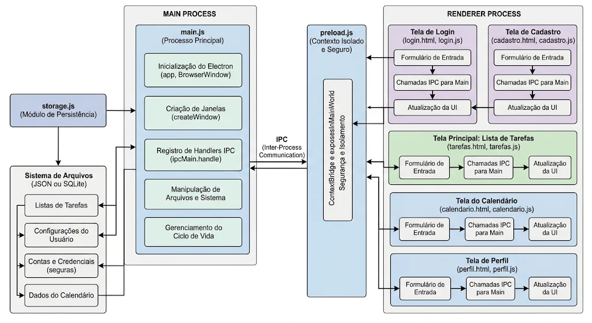

# FlowList

Aplicação desktop desenvolvida com **Electron**, **HTML**, **CSS** e **JavaScript**, com interface construída utilizando **Bootstrap**. O FlowList foi criado para ajudar o usuário a organizar suas tarefas, acompanhar prazos e visualizar seus compromissos em um calendário.

## Funcionalidades

- **Cadastro de usuário:** criação de conta com nome, e-mail e senha.
- **Login:** autenticação para acessar as funcionalidades do aplicativo.
- **Página inicial:** visão geral das tarefas, com destaque para as atividades do dia e as atrasadas.
- **Gerenciamento de tarefas:** criação, edição, exclusão e conclusão de tarefas.
- **Organização por prioridade:** classificação das tarefas em alta, média e baixa.
- **Filtros:** visualização de todas as tarefas, pendentes, atrasadas ou concluídas.
- **Calendário:** visualização das datas e das tarefas associadas a cada dia.
- **Perfil:** consulta e edição de informações da conta, alteração de senha e visualização de estatísticas das tarefas.
- **Armazenamento local:** os dados de usuários e tarefas são mantidos no armazenamento local do aplicativo.

## Fluxo de uso

1. Ao abrir o aplicativo, o usuário encontra a tela de login.
2. Caso ainda não tenha uma conta, pode acessar a tela de cadastro.
3. Depois de realizar o login, é direcionado à página inicial.
4. Na página inicial, pode adicionar tarefas e acompanhar as atividades do dia e as atrasadas.
5. Na área **Minhas tarefas**, pode organizar, editar, excluir, concluir e filtrar suas tarefas.
6. No **Calendário**, pode visualizar as tarefas de acordo com as datas.
7. Na área **Perfil**, pode consultar e atualizar seus dados e acompanhar seu desempenho.

## Tecnologias utilizadas

- [Electron](https://www.electronjs.org/) — criação da aplicação desktop.
- HTML5 — estrutura das telas.
- CSS3 — estilização e identidade visual.
- JavaScript — funcionalidades e regras da aplicação.
- [Bootstrap 5](https://getbootstrap.com/) — componentes e recursos de interface.
- [Bootstrap Icons](https://icons.getbootstrap.com/) — ícones utilizados na interface.
- [Fontsource Inter](https://fontsource.org/fonts/inter) — fonte tipográfica Inter.
- Node.js e npm — ambiente e gerenciamento das dependências.

## Organização do projeto

```text
 desktop-tutorial/
 ├── main.js
 ├── package.json
 ├── package-lock.json
 ├── fluxograma.png
 └── src/
     ├── cadastro/       # Tela e lógica de cadastro
     ├── login/          # Tela e lógica de login
     ├── principal/      # Página inicial e resumo das tarefas
     ├── tarefas/        # Gerenciamento das tarefas
     ├── calendario/     # Calendário e visualização por data
     ├── perfil/         # Dados da conta e estatísticas
     ├── componentes/    # Menu, navegação e componentes compartilhados
     ├── imagens/        # Imagens e ícones do aplicativo
     ├── preload/        # Comunicação controlada entre a interface e o Electron
     └── storage.js      # Funções de armazenamento e gerenciamento dos dados
```

O arquivo `main.js` configura a janela e os recursos principais do Electron. A pasta `src` reúne as telas e seus arquivos de estilo e comportamento. O arquivo `storage.js` centraliza operações relacionadas aos dados armazenados localmente, enquanto `preload.js` disponibiliza uma comunicação controlada entre a interface e o processo principal.

## Como executar o projeto

### Pré-requisitos

- [Node.js](https://nodejs.org/) instalado.
- npm, instalado junto com o Node.js.

### Instalação

1. Clone o repositório:

   ```bash
   git clone https://github.com/Karollayne802/desktop-tutorial.git
   ```

2. Acesse a pasta do projeto:

   ```bash
   cd desktop-tutorial
   ```

3. Instale as dependências:

   ```bash
   npm install
   ```

4. Inicie o aplicativo:

   ```bash
   npm start
   ```

## Armazenamento e segurança

As informações das contas e das tarefas são armazenadas localmente por meio do `localStorage` do aplicativo. As senhas são processadas com **PBKDF2-SHA-256**, utilizando salt aleatório e 310.000 iterações.

Como os dados ficam no próprio dispositivo, o armazenamento local é adequado ao contexto didático do projeto, mas não deve ser considerado uma solução de segurança para informações sensíveis.

## Fluxograma

O fluxograma apresenta uma visão do fluxo de utilização da aplicação.



## Equipe

- Arthur Lima
- Karollayne Correia
- **[Adicionar nome do terceiro integrante]**

---

Projeto desenvolvido como atividade acadêmica utilizando Electron e Bootstrap.
