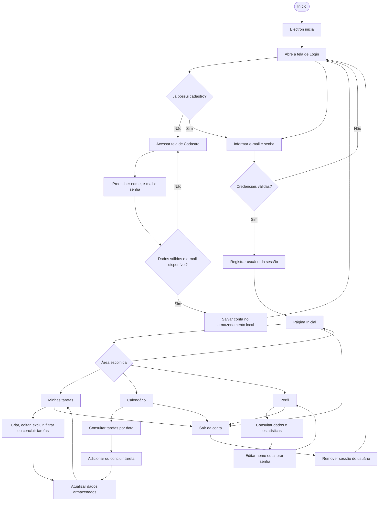

# FlowList

Aplicativo desktop de organização pessoal desenvolvido com **Electron**, **HTML5**, **CSS3** e **JavaScript**, com componentes de interface do **Bootstrap 5**.

O FlowList permite criar uma conta, entrar no aplicativo e organizar tarefas por prazo e prioridade. Também oferece uma página inicial com visão geral das atividades, um calendário e uma área de perfil para consultar e atualizar informações da conta.

---

## Sobre o projeto

O FlowList foi desenvolvido como uma aplicação desktop para facilitar o planejamento e o acompanhamento de tarefas do dia a dia. A proposta é reunir, em um único ambiente, o cadastro e o acesso do usuário, o gerenciamento de atividades e a visualização dos compromissos por data.

A aplicação foi construída com Electron, que permite executar tecnologias web em uma janela de desktop. A interface é organizada em telas independentes, enquanto funções compartilhadas cuidam do armazenamento, da navegação e de componentes reutilizados.

## Funcionalidades

### 1. Cadastro de usuário
- Cadastro com nome, e-mail e senha.
- Validação dos campos preenchidos.
- Verificação para evitar o cadastro de e-mails já utilizados.
- Confirmação da senha antes de concluir o cadastro.

### 2. Login
- Acesso por e-mail e senha cadastrados.
- Verificação das credenciais informadas.
- Mensagens para orientar o usuário em caso de preenchimento inválido ou falha na autenticação.
- Identificação da sessão do usuário que entrou no aplicativo.

### 3. Página inicial
- Apresentação de uma visão geral das atividades.
- Destaque para tarefas do dia e tarefas atrasadas.
- Acesso às principais áreas do aplicativo.
- Atalho para adicionar uma nova tarefa.

### 4. Gerenciamento de tarefas
- Criação de tarefas com título, prazo e prioridade.
- Edição de tarefas já cadastradas.
- Exclusão de tarefas.
- Marcação e desmarcação de tarefas como concluídas.
- Filtros para visualizar diferentes grupos de tarefas.
- Identificação de tarefas atrasadas de acordo com o prazo e a conclusão.

As prioridades disponíveis são **Alta**, **Média** e **Baixa**.

### 5. Calendário
- Visualização mensal em formato de calendário.
- Navegação entre as datas.
- Exibição das tarefas associadas aos dias.
- Possibilidade de adicionar tarefas a partir de uma data selecionada.
- Atualização da visualização conforme as tarefas são alteradas.

### 6. Perfil
- Consulta dos dados da conta.
- Edição do nome do usuário.
- Alteração de senha mediante confirmação da senha atual.
- Visualização de informações e estatísticas relacionadas às tarefas.

## Como o aplicativo funciona

1. Ao iniciar, o Electron abre a janela do FlowList na tela de login.
2. Se a pessoa ainda não possuir uma conta, poderá acessar o cadastro e preencher os dados solicitados.
3. O aplicativo valida as informações e registra a nova conta no armazenamento local.
4. Com uma conta cadastrada, a pessoa informa e-mail e senha na tela de login.
5. Após a autenticação, a sessão do usuário é registrada e a navegação para as áreas internas fica disponível.
6. Na página inicial, é possível acompanhar um resumo das tarefas e acessar as demais telas.
7. Em **Minhas tarefas**, é possível criar, editar, excluir, filtrar e concluir atividades.
8. No **Calendário**, as tarefas são organizadas visualmente de acordo com seus prazos.
9. Em **Perfil**, o usuário pode consultar e atualizar informações da conta.
10. Ao sair, a identificação da sessão é removida.

## Fluxograma de navegação

O diagrama abaixo representa o fluxo principal de utilização do FlowList, desde a abertura do aplicativo até o acesso às funcionalidades internas.



> **Observação:** o fluxograma representa o fluxo funcional da aplicação. A comunicação entre as telas e o Electron é realizada separadamente por meio do processo de preload e de chamadas IPC, descritos na seção de arquitetura.

## Tecnologias utilizadas

| Tecnologia | Utilização no projeto |
|---|---|
| [Electron](https://www.electronjs.org/) | Criação da aplicação desktop e gerenciamento da janela. |
| [Node.js](https://nodejs.org/) | Ambiente de execução utilizado pelo Electron e pelas ferramentas do projeto. |
| HTML5 | Estrutura das telas e dos formulários. |
| CSS3 | Estilização, organização visual e identidade da aplicação. |
| JavaScript | Validações, navegação, manipulação de tarefas e regras de funcionamento. |
| [Bootstrap 5](https://getbootstrap.com/) | Recursos e componentes para construção da interface. |
| [Bootstrap Icons](https://icons.getbootstrap.com/) | Ícones utilizados nas telas. |
| [Fontsource – Inter](https://fontsource.org/fonts/inter) | Disponibilização local da família tipográfica Inter. |
| npm | Instalação e gerenciamento das dependências. |

## Estrutura de pastas

```text
FlowList-main/
├── main.js
├── package.json
├── package-lock.json
├── .gitignore
└── src/
    ├── cadastro/
    │   ├── cadastro.html
    │   ├── cadastro.css
    │   └── cadastro.js
    ├── login/
    │   ├── login.html
    │   └── login.js
    ├── principal/
    │   ├── principal.html
    │   ├── principal.css
    │   └── principal.js
    ├── tarefas/
    │   ├── tarefas.html
    │   ├── tarefas.css
    │   └── tarefas.js
    ├── calendario/
    │   ├── calendario.html
    │   ├── calendario.css
    │   └── calendario.js
    ├── perfil/
    │   ├── perfil.html
    │   ├── perfil.css
    │   └── perfil.js
    ├── componentes/
    │   ├── datas.js
    │   ├── menu.html
    │   ├── menu.css
    │   ├── menu.js
    │   ├── minicalendario.js
    │   ├── navegacao.js
    │   └── telas.css
    ├── imagens/
    │   └── icon.png
    ├── preload/
    │   └── preload.js
    └── storage.js
```

### Responsabilidade dos principais arquivos

- **`main.js`:** inicia o Electron, configura a janela principal, define a tela inicial e registra os canais IPC permitidos.
- **`src/preload/preload.js`:** disponibiliza à interface uma API controlada por meio de `contextBridge`, permitindo solicitar funções específicas ao processo principal.
- **`src/storage.js`:** reúne as operações de cadastro, autenticação, sessão, tarefas e dados do perfil, utilizando o `localStorage`.
- **`src/componentes/`:** contém recursos compartilhados entre as telas, como menu, navegação e funções relacionadas a datas.
- **Pastas de telas:** cada área principal possui seus arquivos HTML e JavaScript; as telas que possuem estilos próprios também contam com um arquivo CSS.

## Arquitetura do Electron

O Electron organiza a aplicação em processos com responsabilidades diferentes:

### Processo principal — `main.js`

É responsável pelo funcionamento geral da aplicação desktop. Neste projeto, ele:
- inicializa o aplicativo e cria a janela com `BrowserWindow`;
- configura dimensões mínimas, ícone e barra de título;
- carrega inicialmente a tela de login;
- restringe a navegação a telas locais autorizadas;
- registra handlers IPC para operações específicas, como obter a versão do aplicativo, carregar o HTML do menu e fechar o aplicativo;
- valida a origem das solicitações IPC antes de atendê-las.

### Processo de renderização — telas da aplicação

É a parte visual que aparece na janela. Cada tela utiliza HTML para a estrutura e JavaScript para as interações. Os scripts das telas também utilizam as funções compartilhadas de `storage.js` para trabalhar com os dados.

### Preload — `src/preload/preload.js`

O preload funciona como uma ponte controlada entre a interface e recursos do Electron. Ele expõe somente os métodos definidos na API `window.api`, sem liberar diretamente o `ipcRenderer` para os scripts das telas.

### Comunicação IPC

IPC significa *Inter-Process Communication* (comunicação entre processos). No FlowList, o preload utiliza `ipcRenderer.invoke()` para solicitar operações registradas no processo principal por `ipcMain.handle()`. Essa comunicação é usada para as funções disponibilizadas pelo `main.js`; o gerenciamento de usuários e tarefas é feito pelas funções de armazenamento executadas na interface.

### Configurações de segurança da janela

A janela utiliza:
- `contextIsolation: true`, para manter isolados os contextos da página e do preload;
- `nodeIntegration: false`, para não disponibilizar APIs do Node diretamente aos scripts da interface;
- `sandbox: true`, para habilitar o isolamento do processo de renderização;
- bloqueio de janelas adicionais e de navegação para páginas não autorizadas.

## Armazenamento de dados

O projeto utiliza o **`localStorage`** para manter os dados no ambiente local do aplicativo. O arquivo `src/storage.js` centraliza as funções que leem, validam e atualizam essas informações.

Entre os dados gerenciados estão:
- **Usuários:** nome, e-mail e informações necessárias à verificação da senha.
- **Sessão:** identificação do usuário atualmente conectado.
- **Tarefas:** título, prazo, prioridade, estado de conclusão e identificação do usuário responsável.
- **Estatísticas:** total de tarefas concluídas por usuário.

As tarefas são associadas ao e-mail do usuário, permitindo filtrar os registros para apresentar somente as atividades da conta conectada.

## Instalação e execução

### Pré-requisitos

- Node.js instalado.
- npm disponível no terminal.
- Sistema operacional compatível com a versão do Electron utilizada.

Para conferir se Node.js e npm estão instalados, execute:

```bash
node -v
npm -v
```

### Passo a passo

1. Abra a pasta do projeto no Visual Studio Code ou em outro terminal.
2. No terminal, confirme que está na pasta que contém o arquivo `package.json`.
3. Instale as dependências:

   ```bash
   npm install
   ```

4. Inicie o aplicativo:

   ```bash
   npm start
   ```

O comando `npm start` executa o script configurado no `package.json`, que inicia o Electron com o projeto atual.

### Dependências

As principais dependências declaradas no projeto são:

- `electron` — dependência de desenvolvimento para executar a aplicação desktop;
- `bootstrap` — biblioteca de interface;
- `bootstrap-icons` — conjunto de ícones;
- `@fontsource/inter` — arquivos locais da fonte Inter.

Não é necessário instalar esses pacotes individualmente: o comando `npm install` instala as dependências declaradas no `package.json`.

## Observações sobre segurança

As senhas novas são processadas com **PBKDF2-SHA-256**, salt aleatório e 310.000 iterações antes de serem armazenadas. O código também mantém compatibilidade de verificação com registros antigos que utilizavam SHA-256 simples e, após uma autenticação válida, tenta atualizar esse registro para o formato PBKDF2.

Apesar desse cuidado, o FlowList é um projeto acadêmico com armazenamento local. O `localStorage` não substitui um banco de dados e uma arquitetura de autenticação próprios para produção. Portanto, não utilize o aplicativo para guardar informações sensíveis ou senhas que também sejam usadas em outros serviços.

## Equipe

- Arthur Lima
- Karollayne Correia

---

Projeto acadêmico desenvolvido com Electron e Bootstrap.
